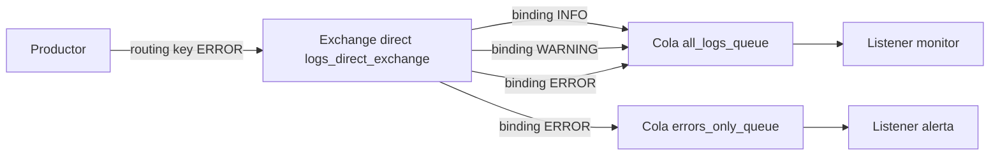
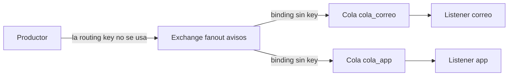
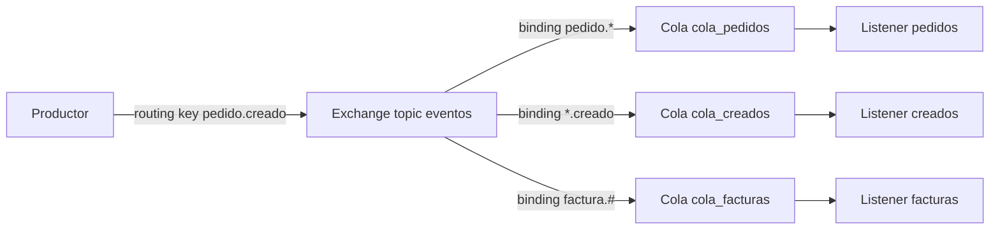
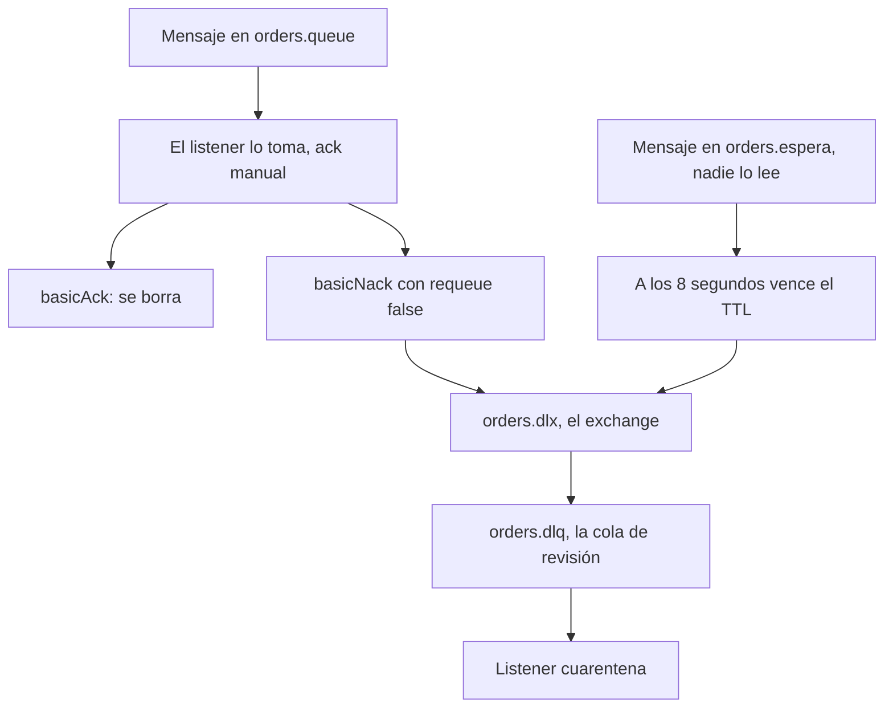

# Demo — direct, fanout, topic y DLQ

Un programa Spring Boot publica mensajes en RabbitMQ cuando llamas a una API. Cada listener anota lo que recibió. `GET /api/recibidos` muestra esas anotaciones.

El productor nombra el **exchange** y la **routing key**. No nombra las colas. Las colas las eligen los **bindings**. El **listener** lee una cola, no el exchange.

| API | Exchange | Qué comprobar en `GET /api/recibidos` |
|---|---|---|
| `POST /api/logs` con `INFO` | direct `logs_direct_exchange` | Solo `monitor` |
| `POST /api/logs` con `ERROR` | direct | `monitor` y `alerta` |
| `POST /api/avisos` | fanout `avisos` | `correo` y `app` |
| `POST /api/eventos` con `pedido.creado` | topic `eventos` | `pedidos` y `creados`. `facturas` no |
| `POST /api/pedidos` con `"fallar": false` | direct `orders.exchange` | `orders.queue` dice `ack`. No hay línea de DLQ |
| `POST /api/pedidos` con `"fallar": true` | direct + DLX | `orders.queue` dice `nack` y `orders.dlq` dice `cuarentena` |
| `POST /api/pedidos/espera` | la cola `orders.espera` no tiene listener | A los 8 segundos aparece en `orders.dlq` |

---

## Cómo levantarlo

Hace falta Docker, Java 17 y Maven.

```bash
cd material\ complementario/demo-exchanges
docker compose up -d
mvn spring-boot:run
```

RabbitMQ queda en `localhost:5672`. La página para mirar colas y bindings es [http://localhost:15672](http://localhost:15672), usuario `guest`, clave `guest`.

La API queda en `http://localhost:8080`. `GET /api` lista las rutas.

Los listeners corren un instante después del `POST`. En la consola donde corre Spring aparece `[PUBLICA]` al entrar el POST y `[LISTENER]` cada vez que se dispara un consumidor. Espera un segundo y pide los recibidos:

```bash
curl -s http://localhost:8080/api/recibidos
```

Para vaciar la lista:

```bash
curl -s -X DELETE http://localhost:8080/api/recibidos
```

En Postman, menú **Import**, archivo `postman/DSY1107-demo-exchanges.postman_collection.json`. En la ventana que lista lo que va a entrar, marca la colección y pulsa **Import** otra vez. Queda en la barra izquierda, pestaña **Collections**, con el nombre `DSY1107 demo exchanges`. Si el buscador de esa pestaña tiene texto, bórralo. El orden de las carpetas es Direct, Fanout, Topic, DLQ y después Recibidos.

---

## Direct

El productor publica una vez, con la routing key `ERROR`. El exchange `logs_direct_exchange` compara esa key con cada binding, letra por letra. Coinciden dos, así que hay dos copias y corren los dos listeners.



Con `ERROR` se usan las dos flechas que dicen `ERROR`: anotan `monitor` y `alerta`. Con `INFO` solo se usa la flecha `INFO`: anota `monitor`. `error` en minúscula no coincide con ningún binding y nadie anota.

```bash
curl -s -X POST http://localhost:8080/api/logs \
  -H "Content-Type: application/json" \
  -d '{"level":"INFO","message":"pedido creado"}'

curl -s -X POST http://localhost:8080/api/logs \
  -H "Content-Type: application/json" \
  -d '{"level":"ERROR","message":"fallo al cobrar"}'
```

En `:15672`, pestaña **Exchanges**, abre `logs_direct_exchange`. Abajo están los cuatro bindings.

---

## Fanout

El productor publica una vez. El exchange `avisos` no mira la routing key. Copia el mensaje a cada cola que tenga un binding, y cada cola tiene su listener.



Un aviso anota dos líneas: `correo` y `app`.

```bash
curl -s -X POST http://localhost:8080/api/avisos \
  -H "Content-Type: application/json" \
  -d '{"message":"pedido listo"}'
```

El binding de fanout no lleva `.with("...")`. Por eso en el código de `RabbitConfig` el bind de `cola_correo` termina en `.to(avisos)`, sin palabra.

---

## Topic

El productor publica con una routing key hecha de palabras separadas por puntos. El exchange compara esa frase con el patrón de cada binding.

- `*` es **una** palabra.
- `#` es **cero o más** palabras.



`pedido.creado` coincide con `pedido.*` y con `*.creado`. Corren `pedidos` y `creados`. No coincide con `factura.#`, así que `facturas` no corre.

`pedido.creado.chile` coincide con `pedido.#` (no está declarado en este demo) y ya no con `pedido.*`, porque `*` acepta una sola palabra. En este demo esa key no entra a `cola_pedidos` ni a `cola_creados`. Entra a ninguna de las tres colas.

`factura.octubre` coincide con `factura.#` y llega solo a `facturas`.

```bash
curl -s -X POST http://localhost:8080/api/eventos \
  -H "Content-Type: application/json" \
  -d '{"routingKey":"pedido.creado","message":"pedido 18"}'

curl -s -X POST http://localhost:8080/api/eventos \
  -H "Content-Type: application/json" \
  -d '{"routingKey":"factura.octubre","message":"boleta 4"}'

curl -s -X POST http://localhost:8080/api/eventos \
  -H "Content-Type: application/json" \
  -d '{"routingKey":"pedido.creado.chile","message":"no calza con pedido.*"}'
```

---

## DLX y DLQ

Un mensaje **muere** cuando ya no vuelve a su cola. Lo recibe un exchange, el DLX, y lo guarda una cola, la DLQ.

En este demo hay dos maneras de verlo.

**El código se rinde.** `POST /api/pedidos` con `"fallar": true` hace que el listener de `orders.queue` llame a `basicNack(tag, false, false)`. El último `false` significa “no lo devuelvas a esta cola”. La cola fue creada con `x-dead-letter-exchange` = `orders.dlx`, así que RabbitMQ entrega el mensaje ahí. `orders.dlx` es fanout y su único binding apunta a `orders.dlq`.

Con `"fallar": false` el listener llama a `basicAck` y el mensaje se borra. No aparece en la DLQ.

**Se le acaba el tiempo.** `POST /api/pedidos/espera` publica en `orders.espera`. Esa cola no tiene listener y tiene `x-message-ttl` de 8 segundos. Al cumplirse, el mensaje muere y sigue el mismo camino: `orders.dlx` y después `orders.dlq`.

`orders.queue` también tiene TTL, de 30 segundos, como en el lab de la semana 10. Como esa cola sí tiene listener, el mensaje se consume al tiro y el TTL no alcanza a cumplirse. El TTL se ve en `orders.espera`, que nadie está leyendo.



```bash
curl -s -X POST http://localhost:8080/api/pedidos \
  -H "Content-Type: application/json" \
  -d '{"id":"18","fallar":false}'

curl -s -X POST http://localhost:8080/api/pedidos \
  -H "Content-Type: application/json" \
  -d '{"id":"19","fallar":true}'

curl -s -X POST http://localhost:8080/api/pedidos/espera \
  -H "Content-Type: application/json" \
  -d '{"id":"20"}'
```

Después del tercer llamado, espera 8 segundos y vuelve a pedir `GET /api/recibidos`. Tienen que aparecer el `ack` del 18, el `nack` del 19, la cuarentena del 19, y más tarde la cuarentena del 20.

En `:15672`, la cola `orders.dlq` es una cola normal. El exchange `orders.dlx` es un fanout. El exchange no guarda el mensaje: lo guarda la DLQ.

Los listeners de logs, avisos y eventos confirman solos cuando el método termina (el modo de Spring por defecto). El de `orders.queue` confirma a mano. Por eso en el código ese listener usa `containerFactory = "manualFactory"` y llama a `basicAck` o `basicNack`.

---

## Dónde está cada cosa en el código

| Pieza | Archivo |
|---|---|
| Exchanges, colas y bindings | `src/main/java/cl/duoc/dsy1107/demo/config/RabbitConfig.java` |
| Las APIs que publican | `src/main/java/cl/duoc/dsy1107/demo/api/DemoController.java` |
| Los listeners | `src/main/java/cl/duoc/dsy1107/demo/mensaje/Oyentes.java` |
| Lo que después muestra `GET /api/recibidos` | `src/main/java/cl/duoc/dsy1107/demo/mensaje/Bandeja.java` |
